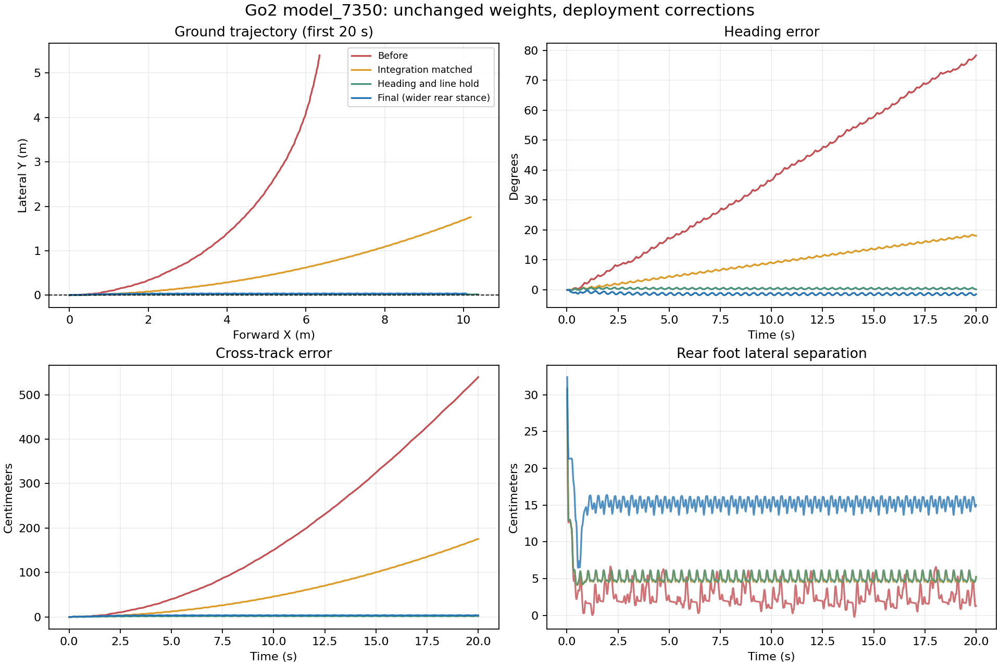

# Go2 Locomotion: Training, Robustness Evaluation & Isaac Sim Deployment

[中文说明](README.zh-CN.md) · [Reproduction](docs/REPRODUCIBILITY.md) · [Full results](docs/RESULTS.md) · [Model card](models/MODEL_CARD.md)

A robotics engineering project that trains a Unitree Go2 walking policy with **Isaac Lab + RSL-RL PPO**, evaluates directional push recovery, and transfers the frozen policy from **Newton/MJWarp to Isaac Sim/PhysX**.

The project-specific work is force-curriculum integration, failure-aware evaluation, seed-level statistical analysis, controlled ablations, and deployment diagnostics. The robot task and PPO implementation come from upstream frameworks; this repository does **not** introduce a new RL algorithm.


**Watch:** [Isaac Sim straight walking](assets/go2-straight-8s.mp4) · [Rear stance](assets/go2-rear-8s.mp4) · [Push recovery before/after](assets/go2-left2-before-after.mp4)

## Results at a glance

| Experiment | Recorded result | Interpretation |
|---|---|---|
| Walking continuation | 192/192 trials passed at 0.3, 0.5 and 0.8 m/s, 30 s/trial | Two evaluation seeds; flat ground, no external pushes |
| Targeted push training | Left 2 BW fall rate **53.81% → 16.31%** | Two frozen checkpoints; 16 paired evaluation seeds, 1,024 trials/condition/model |
| Training ablation | 3 recipes × 8 training seeds; **435,200** matrix trials including baseline | No statistically significant primary contrast after Holm correction |
| Isaac Sim deployment | At 0.5 m/s for 30 s: max lateral deviation **4.17 cm**, max heading error **1.82°**, no fall | Original policy + deployment corrections and external line/heading feedback |

The targeted-training confidence interval for the fall-rate change is **−40.53 to −34.38 percentage points** (paired evaluation-seed bootstrap). It compares specific checkpoints; it does not establish the curriculum's causal superiority. Recovery also became slower in some backward/right conditions. [All results and tradeoffs →](docs/RESULTS.md)

## What this repository contains

```text
experiments/                 Training callbacks, evaluation protocols, statistics and tests
  walking/ push/ robust/ heldout/ left2/ ablation/
deployment/isaacsim/          Native policy runner, diagnostics, line controller, demo UI
  artifact/                  Frozen TorchScript policy, checkpoint and training descriptors
results/data/                Sanitized reports, trial outcomes and compressed large JSON
results/manifest.json         Imported-file checksums and historical-source checksums
assets/                      Recorded videos, screenshots and measured result plots
environment/                 Captured package inventories for two isolated environments
docs/                        Methods, reproduction, limitations and historical reports
tools/                       CPU test runner and repository/evidence checks
```

## Engineering workflow

1. **Train locomotion.** Continue a short PPO run with 2,048 parallel environments. Require forward progress and stable posture rather than treating “not falling” as walking.
2. **Measure push response.** Apply actual forces at the base center of mass, verify the force buffer, and retain failures even when the simulator resets the robot.
3. **Improve and verify.** Add directional curricula; freeze checkpoints and evaluate on new seed panels. Analyze paired seeds instead of counting vectorized environments as independent training runs.
4. **Test the hypothesis.** Compare uniform directions, weighted directions, and weighted directions with a curriculum at the same 2,400-update budget across eight training seeds.
5. **Transfer the policy.** Check observation/action ordering, actuator schema compatibility and effective integration step before adjusting behavior.
6. **Make straightness observable.** Add a 1 m grid, fixed target line, actual trajectory, heading vector and foot markers. Log heading and cross-track error in world coordinates.

## Inspect or test without simulation

These checks only read the repository and run CPU logic; they do not train or start Isaac Sim:

```bash
python tools/verify_repository.py
python tools/run_tests.py
```

With NumPy, SciPy and CPU PyTorch installed in your chosen environment, run the numerical/controller tests and recompute headline statistics:

```bash
python tools/run_tests.py --numerical
python tools/check_results.py
```

Simulation requires a separate, compatible NVIDIA environment. See [reproduction instructions](docs/REPRODUCIBILITY.md) before launching anything. The captured package lists are environment records, **not** a portable one-command installer. A clean-machine end-to-end rebuild has not been verified.

## Deployment correction, without retraining

The original training integration used 0.005 s steps with two substeps. The final PhysX configuration uses a 0.0025 s integration step and decimation 8, preserving the **50 Hz** policy period. A bounded controller supplies lateral/yaw commands for the world-frame target line:

```text
vy = clip(−0.5 × lateral_error, ±0.15 m/s)
wz = clip(−1.5 × heading_error − 0.4 × lateral_error, ±0.6 rad/s)
```

Rear hip action offsets of +0.1 rad (RL) and −0.1 rad (RR) widen the stance; the observation reference and actor weights remain unchanged. These offsets have **not** been validated for push recovery, other terrain or hardware. At 0.3 m/s, startup heading reached 4.82°, exceeding the strict 3° criterion. [Diagnostics →](docs/DEPLOYMENT.md)



## Scope and attribution

All reported experiments are simulated flat-ground tests. There is no real-robot validation, and the deployment controller uses simulator ground-truth pose. Recorded demonstrations are examples, not statistical replicates.

Built on [Isaac Lab](https://github.com/isaac-sim/IsaacLab), [RSL-RL](https://github.com/leggedrobotics/rsl_rl), [Newton](https://github.com/newton-physics/newton) and NVIDIA Isaac Sim. Third-party applications, drivers, robot USD assets and upstream source trees are not redistributed. See [attribution and rights](THIRD_PARTY.md). The project owner's code/model reuse license is pending; public visibility alone is not a permissive license.
