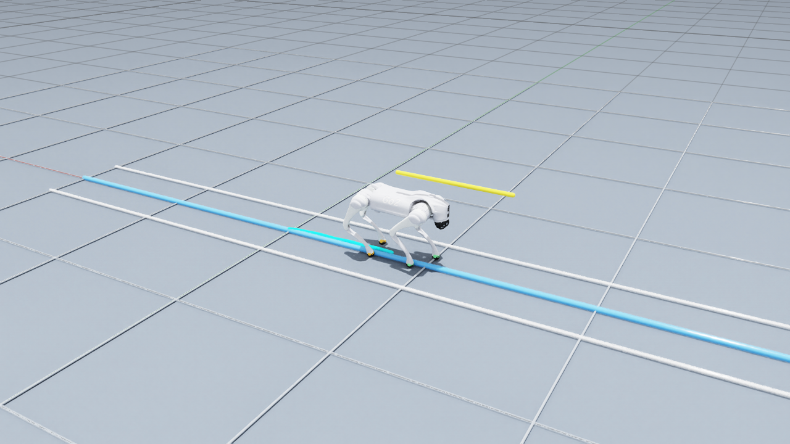

# Go2 强化学习行走、抗推扰评估与 Isaac Sim 部署

[English](README.md) · [复现说明](docs/REPRODUCIBILITY.md) · [实验结果](docs/RESULTS.md) · [模型说明](models/MODEL_CARD.md)

本项目基于官方 Isaac Lab Go2 任务与 RSL-RL PPO，完成从行走训练、真实外力推扰、独立种子评估、多训练种子消融，到 Newton/MJWarp → Isaac Sim/PhysX 策略迁移的完整工程流程。

项目贡献在于课程与训练回调、评估协议、统计验证、部署适配和可视化诊断；机器人基础任务和 PPO 来自上游框架，不宣称提出新算法。



演示：[直线行走](assets/go2-straight-8s.mp4) · [后腿姿态](assets/go2-rear-8s.mp4) · [抗推扰前后对比](assets/go2-left2-before-after.mp4)

## 可以展示的结果

| 工作 | 结果 | 必须同时说明的边界 |
|---|---|---|
| PPO 行走继续训练 | 0.3/0.5/0.8 m/s，192/192 次行走验收通过 | 平地、两个评估种子、每次 30 秒，无外推扰 |
| 定向抗推扰继续训练 | 左侧 2 BW 跌倒率 53.81% → 16.31% | 16 个配对评估种子，每条件每模型 1,024 次；比较两个固定模型 |
| 三组训练消融 | 3 组 × 8 个训练种子，共 435,200 次矩阵评估 | 主比较未达到 Holm 校正后的显著性，不能宣称课程算法优越 |
| Isaac Sim 直线部署 | 0.5 m/s、30 秒，最大横向误差 4.17 cm、最大偏航 1.82°、未跌倒 | 原策略加部署修正、航向反馈及后髋偏置，没有重新训练 |

左侧强推扰跌倒率差的种子配对 bootstrap 95% 区间为 −40.53 到 −34.38 个百分点。其他方向部分成功样本的恢复时间变慢，完整结果保留在[结果说明](docs/RESULTS.md)。0.3 m/s 部署起步时最大偏航 4.82°，没有通过严格的 3° 门槛。

## 如何看有没有偏航

场景内蓝线是固定的目标路线，青色线记录机身真实轨迹，黄色线表示机身朝向。1 m 网格提供距离参照，前脚绿色、后脚橙色标记帮助判断落脚位置。判断依据是世界坐标下横向位移和航向角，不依赖跟随相机的视觉印象。

后腿并拢也存在于原 Newton 策略，说明并非单纯视角问题。部署层后髋动作偏置把稳态平均后脚宽度从约 5 cm 调整为约 15 cm；这属于工程补偿，不能据此宣称策略已学会更健康步态，尚未验证补偿后的抗扰性和真机效果。

## 文件与验证

- `experiments/`：课程、训练回调、推扰评估、统计和相关单元测试。
- `deployment/isaacsim/`：原模型导出、接口描述、直线控制与场景演示。
- `results/data/`：去除机器标识后的汇总和逐次指标；较大 JSON 使用 gzip。
- `assets/`：实际录像、图表、截图；`docs/archive/`：历史报告。
- `tools/`：无需仿真的结构检查、CPU 测试及结果复算入口。

先运行仓库检查与基础测试，只读取文件和执行 CPU 逻辑，不训练、不启动仿真：

```bash
python tools/verify_repository.py
python tools/run_tests.py
```

完整数值测试需要 NumPy、SciPy 和 PyTorch；具体部署、资源消耗与复现边界见[复现说明](docs/REPRODUCIBILITY.md)。包版本清单是原环境记录，不保证在新机器上直接安装成功。

## 来源与限制

本项目依赖 [Isaac Lab](https://github.com/isaac-sim/IsaacLab) 和 [RSL-RL](https://github.com/leggedrobotics/rsl_rl)。未打包第三方仿真器、驱动、机器人 USD 资产或账号信息。上游权利与本项目待定的代码/模型许可见 [THIRD_PARTY.md](THIRD_PARTY.md)。目前仅验证仿真平地，不涉及实机部署。
