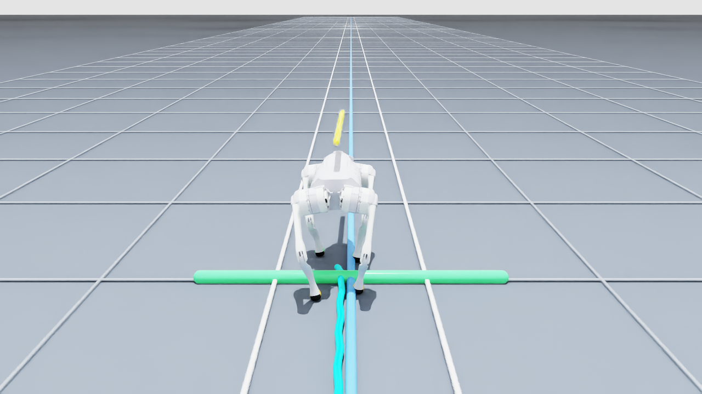

# Newton to PhysX deployment

The shipped actor is the model_7350 TorchScript export, with 48 observations and 12 actions at 50 Hz. `env.yaml` and `IO_descriptors.yaml` preserve the training interface; the adapter derives separate runtime YAML files, leaving those inputs unchanged.

## Findings

- Training: Newton/MJWarp, dt=0.005 s with two integration substeps; 50 Hz policy updates.
- Initial transfer: PhysX integration at 0.005 s. Matching 0.0025 s integration with decimation 8 substantially reduced drift.
- Newer actuator configuration field names required mapping into the native runner's limit fields. This was a compatibility defect, but fixing it alone did not explain the observed yaw.
- Commanding zero yaw rate does not maintain a fixed global heading after transient errors. The training command generator included heading behavior; direct deployment needs explicit line/heading commands for this demonstration.
- Narrow rear stance was measurable in the original Newton policy too. Rear action offsets widen the stance without changing actor weights or observation references.

## Controller

For a robot starting at identity orientation on the world +X target line Y=0:

```text
command_vx = requested speed
command_vy = clip(−0.5 Y, −0.15, +0.15)
command_wz = clip(−1.5 yaw − 0.4 Y, −0.6, +0.6)
rear_hip_action_offset: RL += 0.1 rad, RR -= 0.1 rad
```

`go2_straight_controller.py` validates inputs, adapts the environment/descriptor with copies, and bounds commands. Stand mode suppresses translation and retains heading hold. This feedback uses simulator ground-truth pose. A real robot would require a validated estimator and safety controller.

## Visual interpretation



Blue = world-fixed target line, cyan = measured trajectory, yellow = body heading; the ground grid spacing is 1 m. Green foot markers identify front feet; orange identifies rear feet. Camera tracking is not a reliable drift metric. Log world Y, unwrapped yaw, base height and body-frame rear-foot separation.

The demo provides Walk/Stand/Reset/Pause and side/rear/top views. It commands stand at X=15 m; braking can overshoot the line. Reset the simulation for independent demonstrations. Running the live script creates a new stage after backing up the current root/session layers; save valuable unsaved scene work first.

## Remaining validation

The wider stance has only been checked on flat ground at three constant speeds. Push recovery after applying the offsets, rough terrain, repeated disturbances, estimator error, actuator mismatch and hardware deployment remain unverified. The maximum 0.3 m/s startup heading error is 4.82°. A better-looking stance is not proof of mechanically optimal gait.
