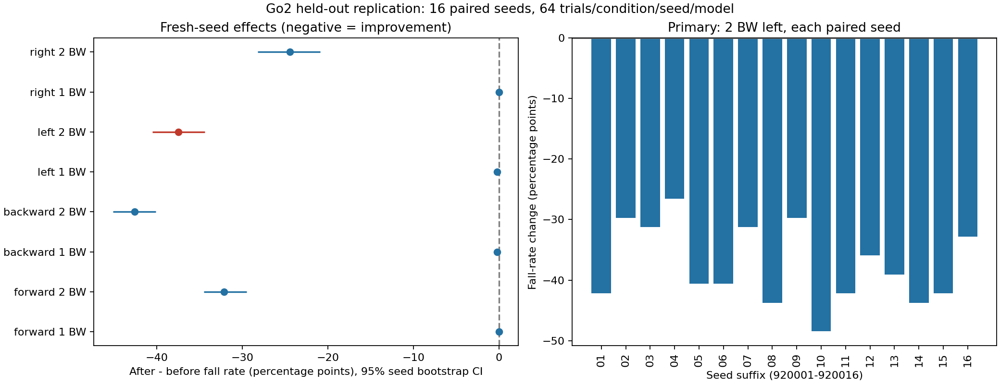
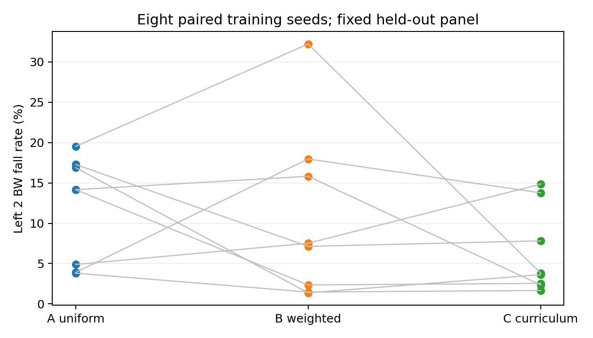

# Results and interpretation

These are recorded experiments, not promises about new hardware or simulator versions. Historical Chinese reports are retained under [archive/](archive/WALKING_RESULTS.md); public identifiers and paths have been redacted.

## Experiment lineage

| Stage | Checkpoint | Purpose |
|---|---|---|
| Short check | model_199 | 200-update initial run; standing was not sufficient for walking acceptance |
| Walking continuation | model_1998 | Forward locomotion and no-push reference |
| Direction-weighted robustness | model_4575 | Improve backward/right push recovery |
| Targeted continuation | model_7350 | Address remaining left 2 BW failures; final deployment model |

Model identities are frozen by SHA256 in the data and [model card](../models/MODEL_CARD.md). Different evaluation seed panels must not be pooled or presented as the same experiment.

## Walking

Continuation from model_199 used 2,048 environments and 1,800 additional PPO updates (88,473,600 transitions). Model_1998 passed 192/192 no-push walking trials: two seeds × 96 trials at 0.3/0.5/0.8 m/s, each lasting 30 s. Mean forward speeds were approximately 0.319/0.545/0.865 m/s. The 200-update baseline had 0/96 walking passes even though 95/96 did not fall.

Evidence: [walking summary](../results/data/walking-summary.json), [historical report](archive/WALKING_RESULTS.md), [video](../assets/go2-walking-demo.mp4).

## Push protocol and held-out replication

At 0.5 m/s on flat ground, apply a force at the base center of mass at t=5 s for 0.2 s, observe until t=15 s. Four directions × 0.25/0.5/1/2 BW plus a no-push control form 17 conditions. BW = trial robot mass × 9.81 N/kg; 2 BW denotes force, not impulse. Direction is computed at push onset and fixed in world coordinates for the push.

Retain randomized material, mass and center of mass. A fall is task base-contact termination, or tilt >60°/height <0.18 m for 0.2 s. Resets cannot erase failure. Recovery requires planar velocity error ≤0.15 m/s, yaw rate magnitude ≤0.30 rad/s, tilt ≤15° and height ≥0.28 m continuously for 0.5 s, with no later fall. Successful recovery times are conditional on success; always read them with recovery proportions.

The initial robustness run included an in-budget curriculum-counter correction. Early diagnostic seeds 42/43 showed left 2 BW worsening from 59.38% to 64.06%. A subsequent fixed-checkpoint replication completed 19/20 planned fresh seed pairs before its time limit: 60.77% → 55.67%, difference −5.10 pp, 95% CI [−8.22, −1.73], exact paired-seed sign-flip p=0.01096. The incomplete pair was excluded by the predefined completeness rule, not replaced. [Replication report](archive/HELDOUT_RESULTS.md)

## Targeted left 2 BW continuation

Model_4575 → model_7350 used a 600 s wall budget and the last complete checkpoint before evaluation. The fixed fresh panel had 16 evaluation seeds (920001–920016), 64 trials/condition/seed/model: **34,816 matrix trials** across two models.

| 2 BW condition | Before | After |
|---|---:|---:|
| Left fall rate | 551/1,024 (53.81%) | 167/1,024 (16.31%) |
| Backward fall rate | 44.04% | 1.46% |
| Right fall rate | 32.42% | 8.01% |

Primary left fall-rate difference: −37.50 pp, paired evaluation-seed bootstrap 95% CI [−40.53, −34.38]; exact two-sided paired sign-flip p=3.05176e−05. This inference concerns the two frozen policies over scene seeds. It is not replicated training-algorithm evidence.

Tradeoff: successful recovery medians at backward/right 1 BW increased from 0.20→0.26 s and 0.40→0.58 s, with small increases in speed error. Do not summarize this as improvement on every metric.

Evidence: [summary](../results/data/left2-heldout-summary.json), [per-seed outcomes](../results/data/left2-heldout-seed-results.json), [historical report](archive/LEFT2_RESULTS.md). Compressed before/after trial outcomes are in `results/data/left2-heldout-*-trials.json.gz`.

## Training-seed ablation: negative primary finding

Three recipes: A uniform directions/no curriculum; B weighted directions/no curriculum; C weighted directions/curriculum. All begin from model_4575 with full training state and run 2,400 updates. There are eight paired training seeds (101–108); each model is evaluated on 16 distinct scene seeds (930001–930016). Baseline plus 24 trained policies total 435,200 matrix trials.

| Contrast | Left 2 BW fall-rate change | 95% paired-training-seed CI | Holm p |
|---|---:|---|---:|
| B−A | −1.10 pp | [−8.05, +6.03] | 0.8438 |
| C−B | −4.43 pp | [−12.57, +1.87] | 0.7500 |
| C−A | −5.53 pp | [−11.77, +1.57] | 0.4453 |

None meets the predefined reliable/practical improvement gate. All groups passed the recorded backward/right retention and no-push walking checks. The default model remained model_7350. Evaluation environments are not independent training replicates.

Evidence: [compressed full summary](../results/data/ablation-summary.json.gz), [results text](../results/data/ablation-results.txt), [experiment specification](../results/data/ablation-spec.json).

## Isaac Sim straight-line deployment

At 0.5 m/s over the controlled 20 s diagnostic runs:

| Configuration | Max lateral deviation | Max heading error | Mean rear-foot width after 2 s |
|---|---:|---:|---:|
| Initial transfer | 5.396 m | 78.34° | 2.57 cm |
| Matched integration | 1.756 m | 18.45° | 4.99 cm |
| + heading/cross-track feedback | 2.35 cm | 0.81° | 5.06 cm |
| + rear hip action offsets | 4.17 cm | 1.82° | 15.22 cm |

The original Newton policy also showed residual yaw and narrow rear stance, so solver transfer is only part of the explanation. Actor tensors match the frozen checkpoint. No retraining occurred during this correction.

Final 30 s validations:

| Command speed | Measured speed | Max lateral deviation | Max heading error | Fall |
|---|---:|---:|---:|---|
| 0.3 m/s | 0.313 m/s | 7.39 cm | 4.82° | No |
| 0.5 m/s | 0.511 m/s | 4.17 cm | 1.82° | No |
| 0.8 m/s | 0.801 m/s | 3.65 cm | 1.25° | No |

The 0.3 m/s startup fails a strict 3° heading threshold. These single-scene runs do not establish randomized robustness. [Saved measurements](../results/data/straight-results.json), [deployment details](DEPLOYMENT.md).
