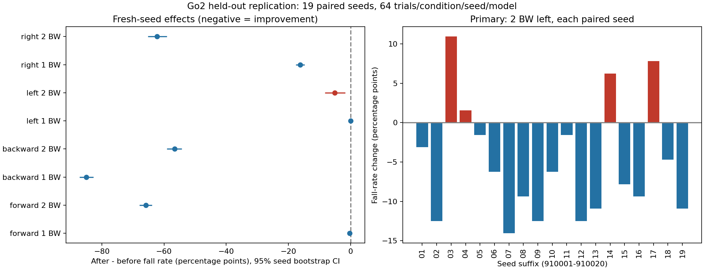

> Historical report. Identifiers were redacted and links adapted for publication. Original machine paths and historical verification statements are not setup instructions.

# Go2 新种子抗推扰复测

日期：2026-10-23；服务器：第二台 `<SSH_HOST>`。

**主要结论：2 BW 向左推扰出现统计上显著的改善。**

此前种子 42、43 的 2 BW 向左跌倒率为 59.38%→64.06%，表现为退步；本次新的独立种子没有复现这一方向的平均退步。这不代表旧结果出错：本次仍有 4 个种子退步，存在场景随机化下的表现差异。旧数据没有合并进入本次检验。

主要比较的跌倒率为 739/1216（60.77%）→677/1216（55.67%）；新模型减旧模型 **-5.10 个百分点**，95% 配对种子 bootstrap 区间 **[-8.22, -1.73] 个百分点**，精确双侧检验 **p=0.0109596**。

19 个种子中，4 个退步、15 个改善、0 个持平。

向后和向右 1 BW 的跌倒率改善均在 19/19 个新种子中复现，次要检验 Holm 校正后 p 均为 5.72205e-05。但新模型在 2 BW 向左仍有 55.67% 的跌倒率，说明抗强推扰能力仍不足。

## 数据和时间边界

- 没有追加训练、调参或选择新检查点；两个冻结模型均为上轮模型。
- 开始前固定 20 个新种子 910001–910020，每个种子每条件每模型 64 次；本轮完整完成 19 个配对种子，每模型 20672 次，合计 41344 次。每条件每模型 1216 次。
- 未完整完成的计划种子：[910020]。只使用两模型均完整结束的种子，没有根据结果补跑、更换种子或延长时间。
- GPU 仿真硬上限 600 秒，第 590 秒发送终止、最多再等 5 秒强制结束；实际预算窗口 590.6 秒，退出码 124（按限时预期停止）。统计计算另限 120 秒，实际 1.47 秒；结果传输和文档整理不占用仿真预算。
- 既有评测记录种子 [42, 43]，训练 YAML 中的种子为 [0, 7]。新种子与当前可核查的项目记录无交集；不对项目以外未知历史作保证。
- 使用原有私有 Python 环境和一张空闲 RTX 5090；不安装依赖、不修改系统驱动或已有环境。

## 固定模型和协议

- 训练前：`IsaacLab/logs/rsl_rl/unitree_go2_flat/2026-10-22_23-07-40_walk_bounded600/model_1998.pt`；SHA256 `f6e4aefb206dfc78d6b78d50cde70b6c273dda44300fa38bc6379766fc5f1ca1`。
- 训练后：`IsaacLab/logs/rsl_rl/unitree_go2_flat/2026-10-23_00-26-28_robust_weighted600_fixed/model_4575.pt`；SHA256 `3dd78eba34c2ce81235c93a31daaca09151d089f3ac0f16df71c85e36b15b994`。
- 方案文件 SHA256：`a711eee72f0caf395b48a77a952dd3df48ab2fb1c66234ce2b87f8f0231ef375`。方案在本次仿真结果产生前锁定，未进行外部预注册。
- 按种子交替 before/after 与 after/before 的顺序；相同种子使用相同场景随机化配置、相同条件和试验编号。
- 两模型同种子同试验的最大质量差 0 kg；这不能证明 GPU 物理轨迹逐位确定。
- 原脚本和指标计算保持不变：平地 0.5 m/s；第 5 秒在 base 质心施力 0.2 秒；按施力时朝向定义方向并固定世界方向；总观察 15 秒；四方向×0.25、0.5、1、2 BW，加无推扰对照；保留质量、材质、质心随机化。
- 每次力缓存校验误差小于 0.01 N。BW 使用该次机器人总质量×9.81；2 BW 是力大小，并非速度或冲量。
- 跌倒：原任务机身接触终止，或倾角超过 60°/高度小于 0.18 m 持续 0.2 秒；自动重置不能抹掉失败。推前跌倒单列，不进入推后跌倒率分母。
- 恢复：撤力后平面速度误差≤0.15 m/s、偏航角速度绝对值≤0.30 rad/s、倾角≤15°、高度≥0.28 m 连续保持 0.5 秒，且之后没有跌倒；恢复时间计到该窗口起点，分辨率 0.02 秒。

## 推断方式

- 主要终点预先指定为 2 BW 向左的跌倒率差；正值表示退步，负值表示改善。每个种子先计算前后差，再对种子等权平均。
- 独立重复单位是配对随机种子。精确双侧符号翻转检验枚举 2^n 个种子层面的符号组合，以 |平均差| 为统计量，显著性门槛 0.05；它依赖零假设下配对差的符号可交换/对称假设，不是对模型标签实际随机分配的试验。
- 95% 区间使用 20000 次整组重采样配对种子的 percentile bootstrap，统计随机种子固定为 20261023。该区间为近似描述，可能与精确检验有轻微差异。
- 其他 15 个受推条件构成次要检验家族，使用 Holm 校正；无推扰仅作描述。主要检验单列，不声称对所有终点统一控制了整体错误率。
- 按原协议报告恢复比例、成功恢复者中位时间、跌倒前平均速度误差；后两项有幸存者选择/观察时长不等的问题，不能单独证明总体性能改善。另报告失败或未恢复记 9.8 秒的封顶恢复分数，作为辅助描述，不解释为最终恢复时间估计。
- 未观察到跌倒而得到 [0,0] 的经验 bootstrap 区间不表示真实风险为零。只有两个冻结模型，没有多个训练种子的独立训练重复；本轮验证环境随机种子的泛化，不足以证明课程算法普遍优于其他训练方法。
- 方法核对：[SciPy 配对置换检验](https://docs.scipy.org/doc/scipy/reference/generated/scipy.stats.permutation_test.html)、[SciPy 配对 bootstrap](https://docs.scipy.org/doc/scipy/reference/generated/scipy.stats.bootstrap.html)。

## 所有条件的跌倒率

| 方向 | BW | 训练前跌倒数/有效数 | 训练后跌倒数/有效数 | 前→后跌倒率 | 差值/百分点 | 95% CI/百分点 | 原始 p | 次要 Holm p |
|---|---:|---:|---:|---:|---:|---|---:|---:|
| 无推扰 | 0 | 0/1216 | 0/1216 | 0.00%→0.00% | +0.00 | [+0.00, +0.00] | 1 | — |
| 向前 | 0.25 | 0/1216 | 0/1216 | 0.00%→0.00% | +0.00 | [+0.00, +0.00] | 1 | 1.000000 |
| 向前 | 0.5 | 0/1216 | 0/1216 | 0.00%→0.00% | +0.00 | [+0.00, +0.00] | 1 | 1.000000 |
| 向前 | 1 | 3/1216 | 0/1216 | 0.25%→0.00% | -0.25 | [-0.49, +0.00] | 0.25 | 1.000000 |
| 向前 | 2 | 1216/1216 | 415/1216 | 100.00%→34.13% | -65.87 | [-67.85, -63.90] | 3.8147e-06 | 0.000057 |
| 向后 | 0.25 | 0/1216 | 0/1216 | 0.00%→0.00% | +0.00 | [+0.00, +0.00] | 1 | 1.000000 |
| 向后 | 0.5 | 1/1216 | 0/1216 | 0.08%→0.00% | -0.08 | [-0.25, +0.00] | 1 | 1.000000 |
| 向后 | 1 | 1034/1216 | 1/1216 | 85.03%→0.08% | -84.95 | [-87.17, -82.73] | 3.8147e-06 | 0.000057 |
| 向后 | 2 | 1216/1216 | 528/1216 | 100.00%→43.42% | -56.58 | [-59.13, -54.28] | 3.8147e-06 | 0.000057 |
| 向左 | 0.25 | 0/1216 | 0/1216 | 0.00%→0.00% | +0.00 | [+0.00, +0.00] | 1 | 1.000000 |
| 向左 | 0.5 | 0/1216 | 0/1216 | 0.00%→0.00% | +0.00 | [+0.00, +0.00] | 1 | 1.000000 |
| 向左 | 1 | 1/1216 | 1/1216 | 0.08%→0.08% | +0.00 | [-0.25, +0.25] | 1 | 1.000000 |
| 向左 | 2 | 739/1216 | 677/1216 | 60.77%→55.67% | -5.10 | [-8.22, -1.73] | 0.0109596 | — |
| 向右 | 0.25 | 0/1216 | 0/1216 | 0.00%→0.00% | +0.00 | [+0.00, +0.00] | 1 | 1.000000 |
| 向右 | 0.5 | 0/1216 | 0/1216 | 0.00%→0.00% | +0.00 | [+0.00, +0.00] | 1 | 1.000000 |
| 向右 | 1 | 197/1216 | 0/1216 | 16.20%→0.00% | -16.20 | [-17.60, -14.72] | 3.8147e-06 | 0.000057 |
| 向右 | 2 | 1150/1216 | 393/1216 | 94.57%→32.32% | -62.25 | [-65.21, -59.13] | 3.8147e-06 | 0.000057 |

## 恢复和速度误差（原指标）

| 方向 | BW | 恢复数：前→后 | 成功恢复中位数/s：前→后 | 推后到首次跌倒前平均速度误差/(m/s)：前→后 | 推前失败：前→后 |
|---|---:|---:|---:|---:|---:|
| 无推扰 | 0 | 1216→1215 | 0.000→0.000 | 0.061→0.047 | 0→0 |
| 向前 | 0.25 | 1216→1216 | 0.040→0.060 | 0.061→0.049 | 0→0 |
| 向前 | 0.5 | 1216→1216 | 0.160→0.200 | 0.066→0.053 | 0→0 |
| 向前 | 1 | 1213→1216 | 0.560→0.440 | 0.104→0.075 | 0→0 |
| 向前 | 2 | 0→800 | —→0.840 | 2.010→0.832 | 0→0 |
| 向后 | 0.25 | 1216→1216 | 0.100→0.040 | 0.063→0.049 | 0→0 |
| 向后 | 0.5 | 1215→1216 | 0.200→0.120 | 0.068→0.051 | 0→0 |
| 向后 | 1 | 182→1215 | 0.560→0.200 | 0.835→0.064 | 0→0 |
| 向后 | 2 | 0→688 | —→0.840 | 1.974→0.800 | 0→0 |
| 向左 | 0.25 | 1216→1216 | 0.160→0.180 | 0.064→0.052 | 0→0 |
| 向左 | 0.5 | 1216→1216 | 0.320→0.220 | 0.072→0.058 | 0→0 |
| 向左 | 1 | 1215→1215 | 0.560→0.420 | 0.105→0.079 | 0→0 |
| 向左 | 2 | 477→539 | 1.080→0.760 | 1.628→1.006 | 0→0 |
| 向右 | 0.25 | 1216→1216 | 0.160→0.160 | 0.065→0.051 | 0→0 |
| 向右 | 0.5 | 1216→1216 | 0.300→0.240 | 0.074→0.059 | 0→0 |
| 向右 | 1 | 1019→1216 | 0.580→0.380 | 0.325→0.081 | 0→0 |
| 向右 | 2 | 66→823 | 1.220→0.780 | 2.377→0.853 | 0→0 |

## 主要条件的辅助指标

- 2 BW 向左恢复率：39.23%→44.33%。
- 成功恢复者中位时间：1.080→0.760 秒；必须结合恢复比例解释。
- 封顶恢复分数均值：6.404→5.829 秒；变化的种子 bootstrap CI [-0.84834375, -0.27956825657894796] 秒。
- 平均速度误差：1.628→1.006 m/s；种子层面变化的 bootstrap CI [-0.6868094242655077, -0.5533335811581639] m/s。

## 文件和验证

- 新增方案、调度、统计、测试、汇总脚本以及本报告：`heldout_plan.json`、`heldout_run.py`、`heldout_analysis.py`、`test_heldout_analysis.py`、`heldout_write_report.py`、`heldout-*.sh`、`HELDOUT_RESULTS.md`。原训练脚本、评测协议、模型权重和当前模型指针未改变。
- `python -m unittest discover -s ${GO2_PROJECT_ROOT}/experiments/heldout -p test_heldout_analysis.py -v`：6/6 通过，含 SciPy 精确检验交叉核对、以种子为重复单位、Holm 校正、恢复失败处理，以及超时进程即使写出了 JSON 也不算完整配对。最后一项在看到复测结果前补充，落实预设的完整配对规则。
- Windows 本地默认 Python 的 NumPy DLL 导入失败，因此没有修复或更换本地环境；本地语法编译通过，数值测试在服务器现有环境运行并通过。
- 最终核对包含模型/方案/原协议校验值、逐次编号唯一性、全部 17 个条件的汇总计数、预算、当前模型指针、显卡进程和依赖兼容性；详见 `heldout-final-check.txt`。
- 最终两张显卡利用率均为 0%，无计算进程；驱动仍为 570.211.01，215 个已安装包兼容性检查通过。仓库的 `pyproject.toml` 和 `uv.lock` 显示的是初始搭建阶段已有修改，本轮未编辑它们。
- 结果目录：`runtime-bridge/artifacts/` 中的 `heldout-summary.json`、`heldout-table.csv`、`heldout-seed-results.json`、两模型逐次 `heldout-*-trials.json`、`heldout-effects.png`、预算/审计/测试记录。完整原始轨迹 `.npz` 和逐次进程日志留在服务器本轮 `reports/heldout/` 目录。
- 本轮没有录制新视频或验证真机、其他地形/速度/推扰时刻，也没有重新训练。以后若根据这批结果调参，这批种子即属于已查看的数据；最终验证应另留新种子。

